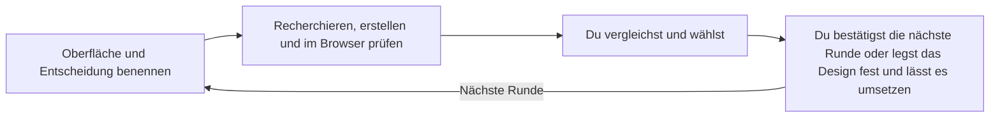

# picky-client

[English](README.md) · [简体中文](README_zh.md) · [繁體中文](README_zh-TW.md) · [日本語](README_ja.md) · [한국어](README_ko.md) · [Türkçe](README_tr.md) · [Русский](README_ru.md) · [Tiếng Việt](README_vi.md) · [ไทย](README_th.md) · **Deutsch** · [Español](README_es.md) · [Français](README_fr.md) · [Українська](README_uk.md) · [Polski](README_pl.md) · [Português (Brasil)](README_pt-BR.md) · [العربية](README_ar.md) · [فارسی](README_fa.md) · [Bahasa Indonesia](README_id.md) · [Italiano](README_it.md) · [Ελληνικά](README_el.md)

**Lass deinen Agenten gestalten. Sei der anspruchsvolle Kunde. Hol das Beste aus dem Design deines Produkts heraus.**

Vergleiche echte UI/UX-Entwürfe und wähle die gewünschte Richtung. Sobald du das Design festlegst, setzt dein Agent es auf der tatsächlichen Oberfläche um und prüft das Ergebnis.

## Starte mit deinem Agenten

Kopiere diese Anfrage in deinen Coding-Agenten:

```text
Lies die README unter https://github.com/daviddev90/picky-client.git und installiere picky-client in deiner eigenen Agentenumgebung.
```

Bitte anschließend in deinem Produktprojekt um eine erste Runde:

```text
Erstelle mit picky-client 3–5 Layoutentwürfe für dieses Dashboard. Behalte die vorhandenen Farben, Schriften und Funktionen bei und lass mich die Entwürfe im Browser vergleichen, bevor ich auswähle.
```

Der Agent recherchiert Beispiele, erstellt die Varianten, prüft ihre tatsächliche Darstellung im Browser und teilt eine für dich erreichbare URL zur Begutachtung. Du siehst dir die Optionen an und wählst aus.

## So funktioniert eine Runde

Dieses Diagramm erklärt den Ablauf:



Jede Runde klärt einen noch offenen Aspekt des Designs. Deine Entscheidungen werden übernommen, damit die nächste Runde auf dem aufbaut, was dir bereits gefällt.

| Deine Entscheidung | Was du vergleichst |
|---|---|
| Stimmung, visueller Charakter oder gleichermaßen nutzbare Kompositionen | Zehn unterschiedliche Richtungen |
| Layout, Bedienelemente, Dichte oder Navigation | Drei bis fünf fundierte Optionen mit Vor- und Nachteilen für die Bedienbarkeit |
| Es bleibt eine sinnvolle Option | Eine begründete Empfehlung |
| Dein Gestaltungsthema steht bereits fest | Optionen, die Farben, Schriftcharakter und Materialwirkung bewahren |

## Auswählen, verfeinern, umsetzen

Teile dem Agenten mit, was du ausgewählt hast und was als Nächstes geschehen soll. Beispielanfragen:

```text
Ich wähle #2. Schlage als Nächstes eine Typografierunde vor und behalte dieses Layout bei.
```

```text
Das Design steht fest. Setze #2 auf der tatsächlichen Oberfläche um und prüfe ihr Verhalten und ihre Zustände.
```

Der Agent wartet auf deine Entscheidung, bevor er fortfährt. Bei der Umsetzung bleiben vorhandene Funktionen erhalten, das gewählte Layout wird mit der tatsächlichen Oberfläche zusammengeführt und das dargestellte Ergebnis wird geprüft.

## Was die Auswahl hilfreich macht

- **Echte Referenzen:** Jede Runde untersucht Dienste mit derselben Funktion oder einer ähnlichen Rolle sowie aktuelle Gestaltungspraxis.
- **Faire Vergleiche:** Geprüfte Texte werden in allen visuellen Varianten gemeinsam verwendet; bereits festgelegte Designentscheidungen bleiben bestehen.
- **Nutzbare Entwürfe:** Darstellung und Navigation werden vor der Übergabe im Browser geprüft. Eine erreichbare URL ermöglicht die Begutachtung auf deinem Gerät.
- **Nachvollziehbare Entscheidungen:** `docs/picky-client.md` in deinem Projekt hält Varianten, Recherche, Prüfungen und Gewinner fest. Die endgültige Spezifikation steht in `docs/picky-client-design.md`.
- **Sauberer Produktionsbuild:** Die temporäre Begutachtungsumgebung und die Codezeilen, die sie in die Anwendung einbinden, werden entfernt. Anschließend wird geprüft, dass sie im Produktionsbuild fehlen.

Die mitgelieferte Begutachtungsumgebung verwendet React, TypeScript, Vite, React Router, Tailwind und Motion. Andere Technologiestacks passen die Integrationspunkte an; native Produkte nutzen zunächst eine Webvorschau, bevor das Design in ihrem eigenen Stack umgesetzt wird. Umgebungen mit Subagenten delegieren Erstellung und Prüfung. Andere Umgebungen führen die Schritte nacheinander aus und dokumentieren die Prüfung durch denselben Agenten.

## Installationsdetails

<details>
<summary>Agentenanweisungen, manuelle Befehle und Aufruf</summary>

### Für den installierenden Agenten

Beachte die vom Nutzer gewünschte Installationsart und ihren Geltungsbereich. Verwende andernfalls für Codex oder Claude Code den unten beschriebenen nativen Plugin-Weg und für andere Umgebungen die passende Skills-CLI-ID. Native Plugins werden standardmäßig für den aktuellen Nutzer installiert, Skills CLI für das Projekt. Installiere den vollständigen Skill-Ordner einschließlich Referenzen, Skripten und Assets. Prüfe, ob der Skill tatsächlich gefunden wird, und erläutere dann seinen Aufruf sowie gegebenenfalls erforderliche Schritte zum Neuladen.

### Skills CLI

Der maßgebliche Skill liegt unter [skills/picky-client](skills/picky-client). Führe die [Skills CLI](https://github.com/vercel-labs/skills) mit Node.js 22.20.0 oder neuer aus deinem Projektverzeichnis aus:

```bash
npx skills add daviddev90/picky-client --skill picky-client
```

Wähle bei der Aufforderung einen Agenten oder gib ihn direkt an:

```bash
npx skills add daviddev90/picky-client --skill picky-client --agent opencode -y
npx skills add daviddev90/picky-client --skill picky-client --agent antigravity -y
```

| Agent | `--agent` ID |
|---|---|
| Codex | `codex` |
| Claude Code | `claude-code` |
| OpenCode, einschließlich oh-my-opencode | `opencode` |
| Antigravity IDE | `antigravity` |
| Antigravity CLI | `antigravity-cli` |
| Cursor | `cursor` |
| GitHub Copilot | `github-copilot` |
| Gemini CLI | `gemini-cli` |
| Cline | `cline` |
| Windsurf | `windsurf` |

Füge `-g` hinzu, um in das nutzerweite Verzeichnis des Agenten zu installieren. Für eine manuelle Projektinstallation kopierst du den gesamten Ordner `skills/picky-client` nach `.agents/skills/`, einem von [OpenCode](https://opencode.ai/docs/skills/) und [Antigravity](https://antigravity.google/docs/skills?app=antigravity-ide) unterstützten Pfad. oh-my-opencode nutzt die Skill-Installation von OpenCode.

### Claude-Code-Plugin

Im Terminal, mit Claude Code 2.1.292 oder neuer:

```bash
claude plugin install picky-client --marketplace daviddev90/picky-client
```

Alternative für ältere Versionen:

```bash
claude plugin marketplace add daviddev90/picky-client
claude plugin install picky-client@daviddev90
```

Innerhalb einer Sitzung unterstützt Version 2.1.275 oder neuer `/plugin install picky-client --marketplace daviddev90/picky-client`. Siehe [Plugin-Installation in Claude Code](https://code.claude.com/docs/en/discover-plugins).

### Codex-Plugin

```bash
codex plugin marketplace add daviddev90/picky-client
codex plugin add picky-client@daviddev90
```

Mit `/plugins` kannst du in Codex Plugins durchsuchen. Siehe die [Codex-CLI-Referenz](https://learn.chatgpt.com/docs/cli/reference).

Beide Plugins verwenden den maßgeblichen Ordner `skills/` im Projektstamm. Die dortige [plugin.json](plugin.json) paketiert das portable/Codex-Plugin; [.claude-plugin/plugin.json](.claude-plugin/plugin.json) stellt die Kompatibilität mit Claude Code bereit. Siehe [Plugin-Paketierung](https://developers.openai.com/plugins/build/plugins).

### Expliziter Aufruf

| Installation | Aufruf |
|---|---|
| Codex-Plugin | `$picky-client:picky-client` |
| Eigenständiger Codex-Skill | `$picky-client` |
| Claude-Code-Plugin | `/picky-client:picky-client` |
| Eigenständiger Claude-Code-Skill | `/picky-client` |

Bitte andere Agenten, picky-client zu verwenden. Varianten und Beschriftungen für die Begutachtung folgen deiner Arbeitssprache; der Werkzeugname bleibt `PICKY-CLIENT DRAFTS`.

</details>

Den vollständigen Ablauf findest du im [Skill](skills/picky-client/SKILL.md). Die [historische Dokumentation](docs/README.md) hält frühere Entscheidungen bei der Gestaltung der Begutachtungsumgebung selbst fest.

## Lizenz

MIT © daviddev90
