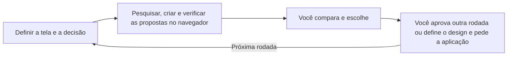

# picky-client

[English](README.md) · [简体中文](README_zh.md) · [繁體中文](README_zh-TW.md) · [日本語](README_ja.md) · [한국어](README_ko.md) · [Türkçe](README_tr.md) · [Русский](README_ru.md) · [Tiếng Việt](README_vi.md) · [ไทย](README_th.md) · [Deutsch](README_de.md) · [Español](README_es.md) · [Français](README_fr.md) · [Українська](README_uk.md) · [Polski](README_pl.md) · **Português (Brasil)** · [العربية](README_ar.md) · [فارسی](README_fa.md) · [Bahasa Indonesia](README_id.md) · [Italiano](README_it.md) · [Ελληνικά](README_el.md)

**Deixe seu agente criar o design. Seja o cliente exigente. Leve a qualidade do design do seu produto ao máximo.**

Compare propostas reais de UI/UX e escolha a direção que preferir. Quando você definir o design, seu agente o aplica à tela real e verifica o resultado.

## Comece com seu agente

Copie este pedido para seu agente de programação:

```text
Leia o README em https://github.com/daviddev90/picky-client.git e instale picky-client no seu próprio ambiente de agente.
```

Depois, no projeto do seu produto, peça uma primeira rodada:

```text
Use picky-client para criar 3–5 propostas de layout para este painel. Mantenha as cores, as fontes e as funcionalidades existentes e deixe que eu compare as propostas em um navegador antes de escolher.
```

O agente pesquisa exemplos, cria as propostas, verifica a renderização real no navegador e compartilha uma URL de revisão que você consegue acessar. Você explora as opções e faz a escolha.

## Como funciona uma rodada

Este diagrama explica o processo:



Cada rodada resolve um aspecto do design que ainda está em aberto. Suas escolhas são mantidas, para que a próxima rodada parta do que você já gostou.

| Sua decisão | O que você compara |
|---|---|
| Atmosfera, personalidade visual ou composições igualmente usáveis | Dez direções distintas |
| Layout, controles, densidade ou navegação | De três a cinco opções fundamentadas, com vantagens e desvantagens de usabilidade |
| Resta uma única opção relevante | Uma recomendação justificada |
| Seu tema já está definido | Opções que preservam suas cores, identidade tipográfica e materiais |

## Escolha, refine, aplique

Diga ao agente o que você escolheu e o que deve acontecer em seguida. Exemplos de pedidos:

```text
Escolho a proposta #2. Agora proponha uma rodada de tipografia mantendo este layout.
```

```text
O design está definido. Aplique a proposta #2 à tela real e verifique seu comportamento e seus estados.
```

O agente espera sua decisão antes de continuar. Aplicar um design inclui preservar as funcionalidades existentes, adaptar o layout escolhido à tela real e verificar o resultado renderizado.

## O que torna as opções úteis

- **Referências reais:** Cada rodada pesquisa serviços com a mesma funcionalidade ou um papel semelhante, além das práticas atuais de design.
- **Comparações justas:** As propostas visuais compartilham textos revisados; decisões de design já definidas permanecem fixas.
- **Propostas usáveis:** A renderização no navegador e a navegação são verificadas antes da entrega, com uma URL acessível para revisão no seu dispositivo.
- **Registro de decisões:** O arquivo `docs/picky-client.md` do seu projeto registra propostas, pesquisas, verificações e escolhas vencedoras. A especificação final fica em `docs/picky-client-design.md`.
- **Build de produção limpa:** O ambiente temporário de revisão e as linhas que o integram à aplicação são removidos, e o resultado de produção é verificado para confirmar sua exclusão.

O ambiente de revisão fornecido usa React, TypeScript, Vite, React Router, Tailwind e Motion. Outras stacks adaptam seus pontos de integração; produtos nativos usam uma prévia web antes da aplicação na própria stack. Ambientes com subagentes delegam a criação e a revisão. Os demais executam as etapas em sequência e registram a revisão feita pelo mesmo agente.

## Detalhes de instalação

<details>
<summary>Instruções para o agente, comandos manuais e invocação</summary>

### Para o agente que realiza a instalação

Respeite o modo e o escopo de instalação solicitados pelo usuário. Caso contrário, use o caminho de plugin nativo abaixo para Codex ou Claude Code e o ID correspondente de Skills CLI para os demais ambientes. Plugins nativos usam, por padrão, o escopo do usuário atual; Skills CLI usa o projeto. Instale a pasta completa do skill, incluindo referências, scripts e recursos. Verifique se o skill é realmente descoberto e depois informe como invocá-lo e quais etapas de recarregamento o ambiente exige.

### Skills CLI

O skill de referência está em [skills/picky-client](skills/picky-client). Execute [Skills CLI](https://github.com/vercel-labs/skills) no diretório do seu projeto com Node.js 22.20.0 ou posterior:

```bash
npx skills add daviddev90/picky-client --skill picky-client
```

Selecione um agente quando solicitado ou especifique um diretamente:

```bash
npx skills add daviddev90/picky-client --skill picky-client --agent opencode -y
npx skills add daviddev90/picky-client --skill picky-client --agent antigravity -y
```

| Agente | `--agent` ID |
|---|---|
| Codex | `codex` |
| Claude Code | `claude-code` |
| OpenCode, incluindo oh-my-opencode | `opencode` |
| Antigravity IDE | `antigravity` |
| Antigravity CLI | `antigravity-cli` |
| Cursor | `cursor` |
| GitHub Copilot | `github-copilot` |
| Gemini CLI | `gemini-cli` |
| Cline | `cline` |
| Windsurf | `windsurf` |

Adicione `-g` para instalar no local do agente compartilhado entre os projetos do usuário. Para uma instalação manual no projeto, copie a pasta inteira `skills/picky-client` para `.agents/skills/`, uma localização compatível com [OpenCode](https://opencode.ai/docs/skills/) e [Antigravity](https://antigravity.google/docs/skills?app=antigravity-ide). oh-my-opencode usa a instalação de skills do OpenCode.

### Plugin do Claude Code

No terminal, com Claude Code 2.1.292 ou posterior:

```bash
claude plugin install picky-client --marketplace daviddev90/picky-client
```

Alternativa para versões anteriores:

```bash
claude plugin marketplace add daviddev90/picky-client
claude plugin install picky-client@daviddev90
```

Dentro de uma sessão, a versão 2.1.275 ou posterior aceita `/plugin install picky-client --marketplace daviddev90/picky-client`. Consulte a [instalação de plugins do Claude Code](https://code.claude.com/docs/en/discover-plugins).

### Plugin do Codex

```bash
codex plugin marketplace add daviddev90/picky-client
codex plugin add picky-client@daviddev90
```

Use `/plugins` dentro do Codex para explorar os plugins. Consulte a [referência do Codex CLI](https://learn.chatgpt.com/docs/cli/reference).

Os dois plugins usam a pasta de referência `skills/` na raiz. O arquivo [plugin.json](plugin.json) da raiz empacota o plugin portátil/para Codex; [.claude-plugin/plugin.json](.claude-plugin/plugin.json) fornece compatibilidade com Claude Code. Consulte o [empacotamento de plugins](https://developers.openai.com/plugins/build/plugins).

### Invocação explícita

| Instalação | Invocação |
|---|---|
| Plugin do Codex | `$picky-client:picky-client` |
| Skill independente do Codex | `$picky-client` |
| Plugin do Claude Code | `/picky-client:picky-client` |
| Skill independente do Claude Code | `/picky-client` |

Em outros agentes, peça para usar picky-client. As propostas e os rótulos de revisão seguem seu idioma de trabalho; o nome da ferramenta permanece `PICKY-CLIENT DRAFTS`.

</details>

Leia o [skill](skills/picky-client/SKILL.md) para conhecer o fluxo completo. O [registro histórico](docs/README.md) documenta escolhas anteriores feitas durante o design do próprio ambiente de revisão.

## Licença

MIT © daviddev90
