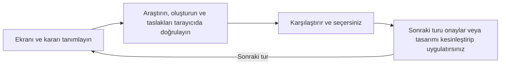

# picky-client

[English](README.md) · [简体中文](README_zh.md) · [繁體中文](README_zh-TW.md) · [日本語](README_ja.md) · [한국어](README_ko.md) · **Türkçe** · [Русский](README_ru.md) · [Tiếng Việt](README_vi.md) · [ไทย](README_th.md) · [Deutsch](README_de.md) · [Español](README_es.md) · [Français](README_fr.md) · [Українська](README_uk.md) · [Polski](README_pl.md) · [Português (Brasil)](README_pt-BR.md) · [العربية](README_ar.md) · [فارسی](README_fa.md) · [Bahasa Indonesia](README_id.md) · [Italiano](README_it.md) · [Ελληνικά](README_el.md)

**Tasarımı ajanınıza bırakın. Titiz müşteri siz olun. Ürününüzün tasarım kalitesini sonuna kadar geliştirin.**

Gerçek UI/UX taslaklarını karşılaştırın ve istediğiniz yönü seçin. Tasarıma son hâlini verdiğinizde ajanınız bunu gerçek ekrana uygular ve sonucu kontrol eder.

## Ajanınızla başlayın

Bu isteği kodlama ajanınıza kopyalayın:

```text
https://github.com/daviddev90/picky-client.git adresindeki README dosyasını oku ve picky-client aracını kendi ajan ortamına kur.
```

Ardından ürün projenizde ilk turu isteyin:

```text
Bu gösterge paneli için picky-client ile 3–5 yerleşim taslağı oluştur. Mevcut renkleri, yazı tiplerini ve özellikleri koru; seçim yapmadan önce taslakları bir tarayıcıda karşılaştırmama olanak ver.
```

Ajan örnekleri araştırır, adayları oluşturur, gerçek tarayıcı görünümlerini kontrol eder ve erişebileceğiniz bir inceleme URL'si paylaşır. Seçenekleri inceleyip seçimi siz yaparsınız.

## Bir tur nasıl işler?

Bu şema süreci açıklar:



Her tur, tasarımın henüz karara bağlanmamış bir yönünü belirler. Seçimleriniz sonraki turlara taşınır; böylece yeni tur, zaten beğendiğiniz kararların üzerine kurulur.

| Vereceğiniz karar | Karşılaştıracağınız seçenekler |
|---|---|
| Atmosfer, görsel karakter veya eşit ölçüde kullanılabilir kompozisyonlar | Birbirinden farklı on yön |
| Yerleşim, kontroller, yoğunluk veya gezinme | Kullanılabilirlik açısından artıları ve eksileri açıklanan, araştırmaya dayalı üç ila beş seçenek |
| Anlamlı tek seçenek kalması | Gerekçeli bir öneri |
| Temanızın zaten belirlenmiş olması | Renkleri, yazı tipi kimliğini ve malzeme özelliklerini koruyan seçenekler |

## Seçin, geliştirin, uygulayın

Ajana neyi seçtiğinizi ve sırada ne olmasını istediğinizi söyleyin. Örnek istekler:

```text
#2 numaralı taslağı seçiyorum. Ardından bu yerleşimi koruyarak bir tipografi turu öner.
```

```text
Tasarım kesinleşti. #2 numaralı taslağı gerçek ekrana uygula; davranışını ve durumlarını doğrula.
```

Ajan devam etmeden önce kararınızı bekler. Tasarımı uygulamak; mevcut işlevleri korumayı, seçilen yerleşimi gerçek ekranla uyumlu hâle getirmeyi ve ekranda oluşan sonucu kontrol etmeyi kapsar.

## Seçimleri yararlı kılan özellikler

- **Gerçek referanslar:** Her turda aynı özelliği sunan veya benzer bir rolü olan hizmetler ve güncel tasarım uygulamaları araştırılır.
- **Adil karşılaştırmalar:** Görsel adaylar aynı gözden geçirilmiş metinleri kullanır; kesinleşmiş tasarım kararları sabit tutulur.
- **Kullanılabilir taslaklar:** Sunumdan önce tarayıcı görünümü ve gezinme kontrol edilir; cihazınızdan inceleyebilmeniz için erişilebilir bir URL verilir.
- **Karar kaydı:** Projenizin `docs/picky-client.md` dosyası adayları, araştırmayı, kontrolleri ve kazananları kaydeder. Kesinleşen tasarım şartnamesi `docs/picky-client-design.md` dosyasına yazılır.
- **Temiz üretim derlemesi:** Geçici inceleme ortamı ve onu uygulamaya bağlayan kod satırları kaldırılır; üretim çıktısında yer almadıkları kontrol edilir.

Birlikte gelen inceleme ortamı React, TypeScript, Vite, React Router, Tailwind ve Motion kullanır. Diğer teknoloji yığınları entegrasyon noktalarını uyarlar; yerel uygulamalar, kendi yığınlarında uygulamadan önce web önizlemesi kullanır. Alt ajanları olan ortamlar oluşturma ve inceleme işlerini devreder. Diğer ortamlar aşamaları sırayla yürütür ve incelemenin aynı ajan tarafından yapıldığını kaydeder.

## Kurulum ayrıntıları

<details>
<summary>Ajan talimatları, elle çalıştırılacak komutlar ve çağırma</summary>

### Kurulumu yapan ajan için

Kullanıcının istediği kurulum biçimine ve kapsamına uyun. Aksi belirtilmedikçe Codex veya Claude Code için aşağıdaki yerleşik eklenti yolunu, diğer ortamlar için uygun Skills CLI kimliğini kullanın. Yerleşik eklentilerin varsayılan kapsamı mevcut kullanıcıdır; Skills CLI'nin varsayılanı projedir. Referanslar, betikler ve varlıklar dâhil skill klasörünün tamamını kurun. Skill'in gerçekten keşfedildiğini doğrulayın; ardından çağırma biçimini ve ortamın gerektirdiği yeniden yükleme adımlarını bildirin.

### Skills CLI

Esas skill [skills/picky-client](skills/picky-client) klasöründedir. Proje dizininizde Node.js 22.20.0 veya üzeriyle [Skills CLI](https://github.com/vercel-labs/skills) aracını çalıştırın:

```bash
npx skills add daviddev90/picky-client --skill picky-client
```

İstendiğinde bir ajan seçin veya doğrudan belirtin:

```bash
npx skills add daviddev90/picky-client --skill picky-client --agent opencode -y
npx skills add daviddev90/picky-client --skill picky-client --agent antigravity -y
```

| Ajan | `--agent` ID |
|---|---|
| Codex | `codex` |
| Claude Code | `claude-code` |
| oh-my-opencode dâhil OpenCode | `opencode` |
| Antigravity IDE | `antigravity` |
| Antigravity CLI | `antigravity-cli` |
| Cursor | `cursor` |
| GitHub Copilot | `github-copilot` |
| Gemini CLI | `gemini-cli` |
| Cline | `cline` |
| Windsurf | `windsurf` |

Ajanın kullanıcı genelindeki konumuna kurmak için `-g` ekleyin. Projeye elle kurulum için `skills/picky-client` klasörünün tamamını [OpenCode](https://opencode.ai/docs/skills/) ve [Antigravity](https://antigravity.google/docs/skills?app=antigravity-ide) tarafından desteklenen `.agents/skills/` konumuna kopyalayın. oh-my-opencode, OpenCode'un skill kurulumunu kullanır.

### Claude Code eklentisi

Terminalde, Claude Code 2.1.292 veya üzeriyle:

```bash
claude plugin install picky-client --marketplace daviddev90/picky-client
```

Eski sürümler için alternatif:

```bash
claude plugin marketplace add daviddev90/picky-client
claude plugin install picky-client@daviddev90
```

Oturum içinde 2.1.275 veya üzeri sürümler `/plugin install picky-client --marketplace daviddev90/picky-client` komutunu destekler. [Claude Code eklenti kurulumu](https://code.claude.com/docs/en/discover-plugins) belgesine bakın.

### Codex eklentisi

```bash
codex plugin marketplace add daviddev90/picky-client
codex plugin add picky-client@daviddev90
```

Codex içinde eklentilere göz atmak için `/plugins` kullanın. [Codex CLI başvurusuna](https://learn.chatgpt.com/docs/cli/reference) bakın.

Her iki eklenti de kökteki esas `skills/` klasörünü kullanır. Kökteki [plugin.json](plugin.json), taşınabilir/Codex eklentisini paketler; [.claude-plugin/plugin.json](.claude-plugin/plugin.json), Claude Code uyumluluğunu sağlar. [Eklenti paketleme](https://developers.openai.com/plugins/build/plugins) belgesine bakın.

### Doğrudan çağırma

| Kurulum | Çağırma |
|---|---|
| Codex eklentisi | `$picky-client:picky-client` |
| Bağımsız Codex skill'i | `$picky-client` |
| Claude Code eklentisi | `/picky-client:picky-client` |
| Bağımsız Claude Code skill'i | `/picky-client` |

Diğer ajanlarda picky-client kullanmasını isteyin. Adaylar ve inceleme etiketleri çalışma dilinizi izler; aracın adı `PICKY-CLIENT DRAFTS` olarak kalır.

</details>

Tam iş akışı için [skill](skills/picky-client/SKILL.md) dosyasını okuyun. [Geçmiş kayıt](docs/README.md), inceleme ortamının kendisi tasarlanırken alınan önceki kararları belgeler.

## Lisans

MIT © daviddev90
