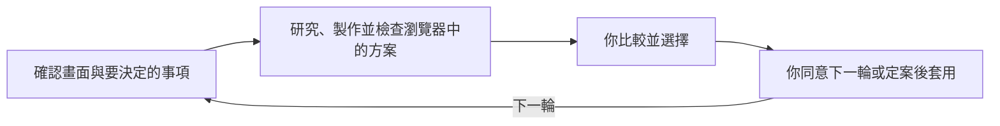

# picky-client

[English](README.md) · [简体中文](README_zh.md) · **繁體中文** · [日本語](README_ja.md) · [한국어](README_ko.md) · [Türkçe](README_tr.md) · [Русский](README_ru.md) · [Tiếng Việt](README_vi.md) · [ไทย](README_th.md) · [Deutsch](README_de.md) · [Español](README_es.md) · [Français](README_fr.md) · [Українська](README_uk.md) · [Polski](README_pl.md) · [Português (Brasil)](README_pt-BR.md) · [العربية](README_ar.md) · [فارسی](README_fa.md) · [Bahasa Indonesia](README_id.md) · [Italiano](README_it.md) · [Ελληνικά](README_el.md)

**讓你的代理程式負責設計，自己當一位挑剔的客戶，把服務的設計品質推向極致。**

比較實際渲染的 UI/UX 設計方案，選出你想要的方向。設計定案後，代理程式會將它套用到實際畫面，並檢查結果。

## 從你的代理程式開始

將下面這句話貼到你的程式開發代理程式中：

```text
請閱讀 https://github.com/daviddev90/picky-client.git 儲存庫中的 README，並在你目前的代理程式環境中安裝 picky-client。
```

安裝完成後，在產品專案中要求第一輪方案：

```text
請用 picky-client 為這個儀表板製作 3–5 個版面配置方案。保留現有色彩、字型和功能，讓我先在瀏覽器中比較，再做選擇。
```

代理程式會研究案例、製作候選方案，檢查它們在瀏覽器中的實際呈現效果，再提供你能開啟的檢視網址。你可以瀏覽方案並做出選擇。

## 一輪如何進行

下圖說明整個流程：



每一輪只決定一個尚未定案的設計面向。已經選定的方向會保留下來，下一輪就在你喜歡的設計基礎上繼續。

| 要決定的事項 | 比較內容 |
|---|---|
| 氛圍、視覺個性，或易用程度相當的構圖 | 10 個各有特色的方向 |
| 版面配置、操作元件、資訊密度或導覽 | 3–5 個有依據的方案，並說明使用上的優缺點 |
| 只剩下一個有意義的選項 | 有依據的建議方案 |
| 主題已經確定 | 保留既定色彩、字型風格和材質表現的方案 |

## 選擇、調整、套用

告訴代理程式你選了哪個方案，以及接下來要做什麼。例如：

```text
我選 2 號方案。請保留這個版面配置，接下來提議一輪文字排版設計比較。
```

```text
設計已經定案。請把 2 號方案套用到實際畫面，並驗證功能和各種畫面狀態。
```

代理程式會等你做出決定後再繼續。套用設計時，會保留現有功能，將選定的版面配置銜接到實際畫面結構，並檢查渲染結果。

## 讓選擇更有價值

- **參考真實案例：** 每輪都會研究提供相同功能或扮演類似角色的服務，並了解目前的設計做法。
- **在相同條件下比較：** 視覺候選方案共用經過審閱的文案，已經確定的設計要素保持不變。
- **交付前先檢查：** 交付前檢查瀏覽器中的呈現效果和畫面切換，並提供你能在自己的裝置上開啟的檢視網址。
- **保留決策紀錄：** 專案的 `docs/picky-client.md` 記錄候選方案、研究、檢查結果和最終選擇。定案後的設計規格保存在 `docs/picky-client-design.md`。
- **清理正式版建置：** 移除臨時檢視介面及其掛載程式碼，並檢查它們已從正式版建置產物中排除。

內建檢視介面使用 React、TypeScript、Vite、React Router、Tailwind 和 Motion。其他技術組合需要調整整合方式；原生產品先用網頁預覽選擇設計，再套用到自己的技術組合中。支援子代理程式的環境會委派製作和審閱工作。其他環境依序執行，並記錄由同一個代理程式完成審閱。

## 安裝詳細說明

<details>
<summary>安裝代理程式須知、手動指令與呼叫方式</summary>

### 給負責安裝的代理程式

優先遵循使用者指定的安裝方式和範圍。未指定時，Codex 或 Claude Code 使用下面的原生外掛方式，其他環境使用對應的 Skills CLI ID。原生外掛預設安裝到目前使用者範圍，Skills CLI 預設安裝到專案範圍。請安裝完整的技能資料夾，包括參考文件、指令碼和資源。確認環境實際能找到該技能後，再說明呼叫方式，以及目前環境要求的重新載入步驟。

### Skills CLI

技能的維護來源位於 [skills/picky-client](skills/picky-client)。使用 Node.js 22.20.0 或更新版本，在專案目錄中執行 [Skills CLI](https://github.com/vercel-labs/skills)：

```bash
npx skills add daviddev90/picky-client --skill picky-client
```

依照提示選擇代理程式，或直接指定：

```bash
npx skills add daviddev90/picky-client --skill picky-client --agent opencode -y
npx skills add daviddev90/picky-client --skill picky-client --agent antigravity -y
```

| 代理程式 | `--agent` ID |
|---|---|
| Codex | `codex` |
| Claude Code | `claude-code` |
| OpenCode，包含 oh-my-opencode | `opencode` |
| Antigravity IDE | `antigravity` |
| Antigravity CLI | `antigravity-cli` |
| Cursor | `cursor` |
| GitHub Copilot | `github-copilot` |
| Gemini CLI | `gemini-cli` |
| Cline | `cline` |
| Windsurf | `windsurf` |

加上 `-g` 可安裝到該代理程式的使用者層級位置。手動安裝到專案時，可將整個 `skills/picky-client` 資料夾複製到 `.agents/skills/`；[OpenCode](https://opencode.ai/docs/skills/) 和 [Antigravity](https://antigravity.google/docs/skills?app=antigravity-ide) 都支援這個路徑。oh-my-opencode 使用 OpenCode 的技能安裝方式。

### Claude Code 外掛

Claude Code 2.1.292 或更新版本，在終端機中執行：

```bash
claude plugin install picky-client --marketplace daviddev90/picky-client
```

舊版本可使用以下兩個指令：

```bash
claude plugin marketplace add daviddev90/picky-client
claude plugin install picky-client@daviddev90
```

在工作階段中，2.1.275 或更新版本支援 `/plugin install picky-client --marketplace daviddev90/picky-client`。請參閱 [Claude Code 外掛安裝文件](https://code.claude.com/docs/en/discover-plugins)。

### Codex 外掛

```bash
codex plugin marketplace add daviddev90/picky-client
codex plugin add picky-client@daviddev90
```

在 Codex 中輸入 `/plugins` 即可瀏覽外掛。請參閱 [Codex CLI 參考文件](https://learn.chatgpt.com/docs/cli/reference)。

兩個外掛都使用根目錄中的技能維護來源 `skills/`。根目錄的 [plugin.json](plugin.json) 用於封裝可攜式／Codex 外掛，[.claude-plugin/plugin.json](.claude-plugin/plugin.json) 提供 Claude Code 相容資訊。請參閱 [外掛封裝文件](https://developers.openai.com/plugins/build/plugins)。

### 直接呼叫

| 安裝方式 | 呼叫方式 |
|---|---|
| Codex 外掛 | `$picky-client:picky-client` |
| Codex 獨立技能 | `$picky-client` |
| Claude Code 外掛 | `/picky-client:picky-client` |
| Claude Code 獨立技能 | `/picky-client` |

在其他代理程式中，請直接要求使用 picky-client。候選方案和檢視介面的標籤會使用你的工作語言，工具名稱維持為 `PICKY-CLIENT DRAFTS`。

</details>

完整流程請閱讀[技能文件](skills/picky-client/SKILL.md)。[歷史紀錄](docs/README.md)記載了早期設計檢視介面本身時做出的選擇。

## 授權條款

MIT © daviddev90
