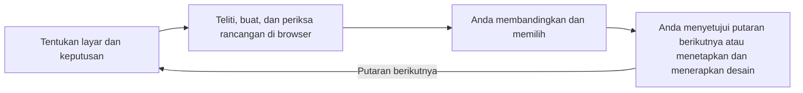

# picky-client

[English](../../README.md) · [简体中文](README_zh.md) · [繁體中文](README_zh-TW.md) · [日本語](README_ja.md) · [한국어](README_ko.md) · [Türkçe](README_tr.md) · [Русский](README_ru.md) · [Tiếng Việt](README_vi.md) · [ไทย](README_th.md) · [Deutsch](README_de.md) · [Español](README_es.md) · [Français](README_fr.md) · [Українська](README_uk.md) · [Polski](README_pl.md) · [Português (Brasil)](README_pt-BR.md) · [العربية](README_ar.md) · [فارسی](README_fa.md) · **Bahasa Indonesia** · [Italiano](README_it.md) · [Ελληνικά](README_el.md)

**Biarkan agen Anda merancang. Jadilah klien yang pemilih. Dorong kualitas desain layanan Anda hingga batasnya.**

Bandingkan rancangan UI/UX yang nyata dan pilih arah yang Anda inginkan. Setelah Anda menetapkan desain, agen akan menerapkannya ke layar produk yang sebenarnya dan memeriksa hasilnya.

## Mulai bersama agen Anda

Salin permintaan ini ke agen pemrograman Anda:

```text
Baca README di https://github.com/daviddev90/picky-client.git dan instal picky-client di lingkungan agenmu sendiri.
```

Lalu, di proyek produk Anda, minta putaran pertama:

```text
Gunakan picky-client untuk membuat 3–5 rancangan tata letak untuk dasbor ini. Pertahankan warna, font, dan fitur yang ada, lalu izinkan saya membandingkan rancangan di browser sebelum memilih.
```

Agen meneliti contoh, membuat kandidat, memeriksa tampilan di browser yang sebenarnya, dan membagikan URL peninjauan yang dapat Anda akses. Anda melihat pilihan yang tersedia dan menentukan pilihan.

## Cara kerja satu putaran

Diagram ini menjelaskan prosesnya:



Setiap putaran memutuskan satu aspek desain yang masih terbuka. Pilihan Anda dipertahankan, sehingga putaran berikutnya mengembangkan hal yang sudah Anda sukai.

| Keputusan Anda | Yang Anda bandingkan |
|---|---|
| Nuansa, karakter visual, atau komposisi yang sama-sama mudah digunakan | Sepuluh arah yang berbeda |
| Tata letak, kontrol, kepadatan, atau navigasi | Tiga hingga lima opsi berlandaskan riset beserta kompromi kegunaannya |
| Hanya tersisa satu opsi yang bermakna | Rekomendasi dengan alasan yang jelas |
| Tema Anda sudah ditetapkan | Opsi yang mempertahankan warna, identitas font, dan materialnya |

## Pilih, sempurnakan, terapkan

Beri tahu agen apa yang Anda pilih dan apa yang harus dilakukan selanjutnya. Contoh permintaan:

```text
Saya memilih #2. Selanjutnya, usulkan putaran tipografi sambil mempertahankan tata letak ini.
```

```text
Desain sudah ditetapkan. Terapkan #2 ke layar produk yang sebenarnya dan periksa perilaku serta statusnya.
```

Agen menunggu keputusan Anda sebelum melanjutkan. Penerapan desain mencakup mempertahankan fungsi yang ada, menyesuaikan tata letak terpilih dengan layar produk yang sebenarnya, dan memeriksa hasil tampilannya.

## Apa yang membuat pilihan ini berguna

- **Referensi nyata:** setiap putaran meneliti layanan dengan fitur yang sama atau peran serupa, sekaligus praktik desain terkini.
- **Perbandingan yang adil:** kandidat visual menggunakan teks bersama yang sudah ditinjau; keputusan desain yang sudah ditetapkan tetap dipertahankan.
- **Rancangan yang dapat digunakan:** tampilan browser dan navigasi diperiksa sebelum diserahkan, dengan URL yang dapat diakses untuk peninjauan di perangkat Anda.
- **Jejak keputusan:** `docs/picky-client.md` di proyek Anda mencatat kandidat, riset, pemeriksaan, dan pemenang. Spesifikasi yang sudah ditetapkan disimpan di `docs/picky-client-design.md`.
- **Build produksi yang bersih:** lingkungan peninjauan sementara dan baris kode yang menghubungkannya ke aplikasi dihapus, lalu hasil build produksi diperiksa untuk memastikan keduanya tidak disertakan.

Lingkungan peninjauan yang disediakan menggunakan React, TypeScript, Vite, React Router, Tailwind, dan Motion. Stack lain menyesuaikan titik integrasinya; produk native menggunakan pratinjau web sebelum desain diterapkan dalam stack-nya sendiri. Lingkungan agen yang memiliki subagen mendelegasikan pembuatan dan peninjauan. Lingkungan lain menjalankan tahap-tahap secara berurutan dan mencatat bahwa peninjauan dilakukan oleh agen yang sama.

## Detail instalasi

<details>
<summary>Instruksi agen, perintah manual, dan pemanggilan</summary>

### Untuk agen yang melakukan instalasi

Ikuti metode dan cakupan instalasi yang diminta pengguna. Jika tidak ditentukan, gunakan jalur plugin native di bawah untuk Codex atau Claude Code, dan ID Skills CLI yang sesuai untuk lingkungan lain. Plugin native secara default berlaku untuk pengguna saat ini; Skills CLI secara default berlaku untuk proyek. Instal seluruh folder skill, termasuk referensi, skrip, dan aset. Pastikan skill benar-benar terdeteksi, lalu laporkan cara pemanggilan dan langkah pemuatan ulang yang diperlukan oleh lingkungan tersebut.

### Skills CLI

Skill acuan berada di [skills/picky-client](../../skills/picky-client). Jalankan [Skills CLI](https://github.com/vercel-labs/skills) dari direktori proyek dengan Node.js 22.20.0 atau yang lebih baru:

```bash
npx skills add daviddev90/picky-client --skill picky-client
```

Pilih agen saat diminta, atau tentukan secara langsung:

```bash
npx skills add daviddev90/picky-client --skill picky-client --agent opencode -y
npx skills add daviddev90/picky-client --skill picky-client --agent antigravity -y
```

| Agen | ID `--agent` |
|---|---|
| Codex | `codex` |
| Claude Code | `claude-code` |
| OpenCode, termasuk oh-my-opencode | `opencode` |
| Antigravity IDE | `antigravity` |
| Antigravity CLI | `antigravity-cli` |
| Cursor | `cursor` |
| GitHub Copilot | `github-copilot` |
| Gemini CLI | `gemini-cli` |
| Cline | `cline` |
| Windsurf | `windsurf` |

Tambahkan `-g` untuk lokasi agen yang berlaku bagi seluruh proyek pengguna tersebut. Untuk instalasi proyek secara manual, salin seluruh folder `skills/picky-client` ke `.agents/skills/`, yang didukung oleh [OpenCode](https://opencode.ai/docs/skills/) dan [Antigravity](https://antigravity.google/docs/skills?app=antigravity-ide). oh-my-opencode menggunakan instalasi skill OpenCode.

### Plugin Claude Code

Di terminal, Claude Code 2.1.292 atau yang lebih baru:

```bash
claude plugin install picky-client --marketplace daviddev90/picky-client
```

Untuk versi yang lebih lama:

```bash
claude plugin marketplace add daviddev90/picky-client
claude plugin install picky-client@daviddev90
```

Di dalam sesi, versi 2.1.275 atau yang lebih baru mendukung `/plugin install picky-client --marketplace daviddev90/picky-client`. Lihat [instalasi plugin Claude Code](https://code.claude.com/docs/en/discover-plugins).

### Plugin Codex

```bash
codex plugin marketplace add daviddev90/picky-client
codex plugin add picky-client@daviddev90
```

Gunakan `/plugins` di dalam Codex untuk menelusuri plugin. Lihat [referensi Codex CLI](https://learn.chatgpt.com/docs/cli/reference).

Kedua plugin menggunakan direktori acuan `skills/` di akar repositori. [plugin.json](../../plugin.json) di akar mengemas plugin portabel/Codex; [.claude-plugin/plugin.json](../../.claude-plugin/plugin.json) menyediakan kompatibilitas Claude Code. Lihat [pengemasan plugin](https://developers.openai.com/plugins/build/plugins).

### Pemanggilan eksplisit

| Instalasi | Pemanggilan |
|---|---|
| Plugin Codex | `$picky-client:picky-client` |
| Skill mandiri Codex | `$picky-client` |
| Plugin Claude Code | `/picky-client:picky-client` |
| Skill mandiri Claude Code | `/picky-client` |

Di agen lain, minta untuk menggunakan picky-client. Kandidat dan label peninjauan mengikuti bahasa kerja Anda; nama alat tetap `PICKY-CLIENT DRAFTS`.

</details>

Baca [skill](../../skills/picky-client/SKILL.md) untuk alur kerja lengkap.

## Lisensi

MIT © daviddev90
