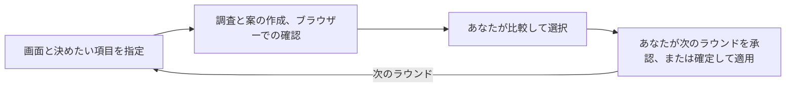

# picky-client

[English](../../README.md) · [简体中文](README_zh.md) · [繁體中文](README_zh-TW.md) · **日本語** · [한국어](README_ko.md) · [Türkçe](README_tr.md) · [Русский](README_ru.md) · [Tiếng Việt](README_vi.md) · [ไทย](README_th.md) · [Deutsch](README_de.md) · [Español](README_es.md) · [Français](README_fr.md) · [Українська](README_uk.md) · [Polski](README_pl.md) · [Português (Brasil)](README_pt-BR.md) · [العربية](README_ar.md) · [فارسی](README_fa.md) · [Bahasa Indonesia](README_id.md) · [Italiano](README_it.md) · [Ελληνικά](README_el.md)

**デザインはエージェントに任せ、あなたはこだわりの強いクライアントに。サービスのデザイン品質を限界まで高めましょう。**

実際に表示した UI/UX のデザイン案を比較し、好みの方向を選びます。デザインを確定すると、エージェントが実際の画面に適用し、結果を確認します。

## エージェントと始める

お使いのコーディングエージェントに、次の文章を貼り付けてください。

```text
https://github.com/daviddev90/picky-client.git の README を読み、現在のエージェント環境に picky-client をインストールしてください。
```

インストールしたら、製品のプロジェクトで最初のラウンドを依頼します。

```text
picky-client を使って、このダッシュボードのレイアウト案を 3–5 個作ってください。既存の色、フォント、機能を維持し、私が選ぶ前にブラウザーで比較できるようにしてください。
```

エージェントが事例を調べ、候補を作成し、ブラウザーでの実際の表示を確認して、アクセスできるレビュー URL を共有します。あなたは候補を見比べて選びます。

## 1 ラウンドの流れ

次の図は作業の流れを説明したものです。



各ラウンドでは、まだ決まっていないデザインの要素を 1 つ決めます。選んだ内容は引き継がれるので、次のラウンドは気に入ったデザインを土台に進められます。

| 決めたいこと | 比較するもの |
|---|---|
| 雰囲気、見た目の個性、または使いやすさが同等の構成 | 方向性の異なる 10 案 |
| レイアウト、操作部品、情報密度、ナビゲーション | 根拠と使いやすさの得失を示した 3–5 案 |
| 意味のある選択肢が 1 つに絞られた場合 | 根拠のある推奨案 |
| テーマがすでに決まっている場合 | 色、フォントの個性、質感を維持した案 |

## 選んで、磨いて、適用する

選んだ案と次に進めたい作業をエージェントに伝えます。依頼の例です。

```text
2 番を選びます。このレイアウトを維持し、次はタイポグラフィを比較するラウンドを提案してください。
```

```text
このデザインで確定します。2 番を実際の画面に適用し、動作と各状態を確認してください。
```

エージェントはあなたの決定を待ってから次に進みます。適用時には既存の機能を維持し、選んだレイアウトを実際の画面構造に合わせて組み込み、表示結果を確認します。

## 納得して選ぶための仕組み

- **実際の事例を調査：** 毎ラウンド、同じ機能や似た役割を持つサービスと、現在のデザインの実践例を調べます。
- **同じ条件で比較：** 見た目を比較する候補は、レビュー済みの文言を共有し、確定したデザイン要素を維持します。
- **確認してから共有：** 共有前にブラウザーでの表示と画面移動を確認し、あなたの端末からアクセスできるレビュー URL を提供します。
- **判断の経緯を記録：** プロジェクトの `docs/picky-client.md` に候補、調査、確認結果、選んだ案を記録します。確定した設計は `docs/picky-client-design.md` にまとめます。
- **本番ビルドを整理：** 一時的なレビュー画面とホスト側の組み込みコードを削除し、本番のビルド結果から除外されたことを確認します。

付属のレビュー画面は React、TypeScript、Vite、React Router、Tailwind、Motion を使用します。他の技術構成では組み込み部分を調整し、ネイティブ製品では Web プレビューで選んだ後、その製品の技術構成に適用します。サブエージェントを使える環境では作成とレビューを委任します。それ以外では順番に実行し、同じエージェントがレビューしたことを記録します。

## インストールの詳細

<details>
<summary>インストールするエージェントへの指示、手動コマンド、呼び出し方法</summary>

### インストールを担当するエージェントへ

ユーザーが指定したインストール方式と範囲を優先してください。指定がなければ、Codex と Claude Code は以下のネイティブプラグイン方式を、それ以外は対応する Skills CLI の ID を使用します。ネイティブプラグインの既定範囲は現在のユーザー、Skills CLI の既定範囲はプロジェクトです。参考文書、スクリプト、アセットを含むスキルフォルダー全体をインストールしてください。実際にスキルが検出されることを確認してから、呼び出し方法と、その環境で必要な再読み込み手順を案内してください。

### Skills CLI

スキルの正本は [skills/picky-client](../../skills/picky-client) です。Node.js 22.20.0 以降の環境で、プロジェクトのディレクトリから [Skills CLI](https://github.com/vercel-labs/skills) を実行します。

```bash
npx skills add daviddev90/picky-client --skill picky-client
```

案内に従ってエージェントを選ぶか、直接指定してください。

```bash
npx skills add daviddev90/picky-client --skill picky-client --agent opencode -y
npx skills add daviddev90/picky-client --skill picky-client --agent antigravity -y
```

| エージェント | `--agent` ID |
|---|---|
| Codex | `codex` |
| Claude Code | `claude-code` |
| OpenCode（oh-my-opencode を含む） | `opencode` |
| Antigravity IDE | `antigravity` |
| Antigravity CLI | `antigravity-cli` |
| Cursor | `cursor` |
| GitHub Copilot | `github-copilot` |
| Gemini CLI | `gemini-cli` |
| Cline | `cline` |
| Windsurf | `windsurf` |

ユーザー全体で使う場所にインストールする場合は `-g` を追加します。手動でプロジェクトにインストールする場合は、`skills/picky-client` フォルダー全体を `.agents/skills/` にコピーしてください。[OpenCode](https://opencode.ai/docs/skills/) と [Antigravity](https://antigravity.google/docs/skills?app=antigravity-ide) はこの場所をサポートしています。oh-my-opencode は OpenCode のスキルインストール方式を使います。

### Claude Code プラグイン

Claude Code 2.1.292 以降では、ターミナルで次を実行します。

```bash
claude plugin install picky-client --marketplace daviddev90/picky-client
```

以前のバージョンでは、次の 2 つのコマンドを使います。

```bash
claude plugin marketplace add daviddev90/picky-client
claude plugin install picky-client@daviddev90
```

セッション内では、2.1.275 以降で `/plugin install picky-client --marketplace daviddev90/picky-client` を使用できます。[Claude Code のプラグインインストール](https://code.claude.com/docs/en/discover-plugins)を参照してください。

### Codex プラグイン

```bash
codex plugin marketplace add daviddev90/picky-client
codex plugin add picky-client@daviddev90
```

Codex 内で `/plugins` を使うと、プラグインを参照できます。[Codex CLI リファレンス](https://learn.chatgpt.com/docs/cli/reference)を参照してください。

どちらのプラグインも、ルートの正本 `skills/` を使います。ルートの [plugin.json](../../plugin.json) はポータブル／Codex プラグインを構成し、[.claude-plugin/plugin.json](../../.claude-plugin/plugin.json) は Claude Code との互換性を提供します。[プラグインのパッケージ構成](https://developers.openai.com/plugins/build/plugins)を参照してください。

### 明示的に呼び出す

| インストール方式 | 呼び出し方法 |
|---|---|
| Codex プラグイン | `$picky-client:picky-client` |
| Codex 単体スキル | `$picky-client` |
| Claude Code プラグイン | `/picky-client:picky-client` |
| Claude Code 単体スキル | `/picky-client` |

他のエージェントでは、picky-client を使うよう依頼してください。候補とレビュー画面のラベルは作業中の言語に合わせ、ツール名は `PICKY-CLIENT DRAFTS` のままにします。

</details>

全体の手順は[スキル文書](../../skills/picky-client/SKILL.md)を参照してください。

## ライセンス

MIT © daviddev90
