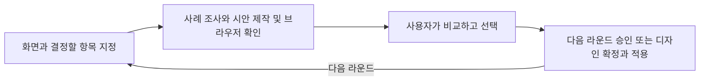

# picky-client

[English](../../README.md) · [简体中文](README_zh.md) · [繁體中文](README_zh-TW.md) · [日本語](README_ja.md) · **한국어** · [Türkçe](README_tr.md) · [Русский](README_ru.md) · [Tiếng Việt](README_vi.md) · [ไทย](README_th.md) · [Deutsch](README_de.md) · [Español](README_es.md) · [Français](README_fr.md) · [Українська](README_uk.md) · [Polski](README_pl.md) · [Português (Brasil)](README_pt-BR.md) · [العربية](README_ar.md) · [فارسی](README_fa.md) · [Bahasa Indonesia](README_id.md) · [Italiano](README_it.md) · [Ελληνικά](README_el.md)

**에이전트에게 디자인을 맡기고, 직접 Picky Client가 되어 서비스 디자인 품질을 극한까지 끌어올리세요.**

실제로 렌더링한 UI/UX 시안을 비교하고 원하는 방향을 고르세요. 디자인을 확정하면 에이전트가 실제 화면에 적용하고 결과를 확인합니다.

## 에이전트와 시작하기

사용 중인 코딩 에이전트에게 다음 문장을 전달하세요.

```text
https://github.com/daviddev90/picky-client.git 저장소의 README를 읽고, 지금 사용 중인 에이전트 환경에 picky-client를 설치해 주세요.
```

설치한 뒤에는 제품 프로젝트에서 첫 시안을 요청하세요.

```text
picky-client로 이 대시보드의 레이아웃 시안 3~5개를 만들어 주세요. 기존 색상과 글꼴, 기능을 유지하고, 제가 고르기 전에 브라우저에서 시안을 비교할 수 있게 해 주세요.
```

에이전트가 사례를 조사하고 시안을 만든 뒤 실제 브라우저 화면을 확인합니다. 전달받은 리뷰 주소를 열어 시안을 비교하고 직접 고르면 됩니다.

## 한 라운드가 진행되는 과정

다음 도식은 작업 흐름을 설명합니다.



라운드마다 아직 정하지 않은 디자인 항목 하나를 결정합니다. 앞에서 고른 방향을 유지하면서 다음 항목을 비교하므로, 선택이 쌓일수록 원하는 디자인에 가까워집니다.

| 결정할 항목 | 비교할 내용 |
|---|---|
| 분위기, 시각적 개성 또는 사용성이 동등한 구성 | 서로 다른 방향을 가진 시안 10개 |
| 배치, 조작 요소, 정보 밀도 또는 탐색 구조 | 사용성 측면에서 장단점을 설명하는 시안 3~5개 |
| 의미 있는 선택지가 하나로 좁혀진 경우 | 근거를 갖춘 권장안 |
| 테마가 이미 정해진 경우 | 기존 색상과 글꼴의 정체성, 재질 표현을 유지하는 시안 |

## 고르고, 다듬고, 적용하기

선택한 시안과 다음에 할 일을 에이전트에게 알려 주세요. 다음과 같이 요청할 수 있습니다.

```text
2번 시안을 고르겠습니다. 이 배치는 유지하면서 다음에는 타이포그래피를 비교하는 라운드를 제안해 주세요.
```

```text
이 디자인으로 확정하겠습니다. 2번 시안을 실제 화면에 적용하고, 기능과 화면 상태를 확인해 주세요.
```

에이전트는 사용자가 결정한 뒤 다음 단계로 진행합니다. 디자인을 적용할 때는 기존 기능을 유지하고, 선택한 배치를 실제 화면 구조에 맞게 옮긴 뒤 렌더링한 결과를 확인합니다.

## 선택에 도움이 되는 방식

- **실제 사례를 조사합니다.** 매 라운드에서 현재 디자인 흐름과 함께 같은 기능이나 비슷한 역할을 제공하는 서비스를 살펴봅니다.
- **같은 조건에서 비교합니다.** 검토한 문구를 시안들이 함께 사용하고, 이미 확정한 디자인 요소를 유지합니다.
- **확인한 시안을 전달합니다.** 브라우저 렌더링과 화면 이동을 확인한 뒤, 사용자의 기기에서 열 수 있는 리뷰 주소를 제공합니다.
- **선택한 이유를 기록합니다.** 프로젝트의 `docs/picky-client.md`에 시안, 조사 내용, 검사 결과와 선택을 남깁니다. 확정한 설계는 `docs/picky-client-design.md`에 정리합니다.
- **운영 빌드를 정리합니다.** 임시 리뷰 화면과 이를 연결한 코드를 제거하고, 운영 빌드 결과에도 포함되지 않았는지 확인합니다.

기본 리뷰 화면은 React, TypeScript, Vite, React Router, Tailwind, Motion을 사용합니다. 다른 기술 구성에서는 연결 부분을 맞추고, 네이티브 제품은 웹 미리보기로 디자인을 고른 뒤 해당 플랫폼에 적용합니다. 서브 에이전트를 지원하는 환경에서는 제작과 검토를 위임합니다. 다른 환경에서는 각 단계를 순서대로 수행하고 같은 에이전트가 검토했음을 기록합니다.

## 자세한 설치 방법

<details>
<summary>설치 담당 에이전트 지침, 직접 실행할 명령과 호출 방법</summary>

### 설치 담당 에이전트 지침

사용자가 지정한 설치 방식과 범위를 우선합니다. 지정하지 않았다면 Codex와 Claude Code에서는 아래 네이티브 플러그인 방식을, 다른 환경에서는 해당 Skills CLI 에이전트 ID를 사용합니다. 네이티브 플러그인은 현재 사용자 범위에, Skills CLI는 현재 프로젝트에 기본 설치합니다. 참고 문서, 스크립트, 자산을 포함한 스킬 폴더 전체를 설치하세요. 실제로 스킬이 검색되는지 확인한 뒤 호출 방법과 해당 환경에서 필요한 재적재 절차를 안내하세요.

### Skills CLI

스킬 정본은 [skills/picky-client](../../skills/picky-client)에 있습니다. Node.js 22.20.0 이상인 환경에서 프로젝트 폴더를 열고 [Skills CLI](https://github.com/vercel-labs/skills)를 실행하세요.

```bash
npx skills add daviddev90/picky-client --skill picky-client
```

안내에 따라 에이전트를 선택하거나 직접 지정하세요.

```bash
npx skills add daviddev90/picky-client --skill picky-client --agent opencode -y
npx skills add daviddev90/picky-client --skill picky-client --agent antigravity -y
```

| 에이전트 | `--agent` ID |
|---|---|
| Codex | `codex` |
| Claude Code | `claude-code` |
| OpenCode 및 oh-my-opencode | `opencode` |
| Antigravity IDE | `antigravity` |
| Antigravity CLI | `antigravity-cli` |
| Cursor | `cursor` |
| GitHub Copilot | `github-copilot` |
| Gemini CLI | `gemini-cli` |
| Cline | `cline` |
| Windsurf | `windsurf` |

사용자 전체 범위에 설치하려면 `-g`를 추가하세요. 프로젝트에 직접 설치할 때는 `skills/picky-client` 폴더 전체를 `.agents/skills/`에 복사할 수 있습니다. [OpenCode](https://opencode.ai/docs/skills/)와 [Antigravity](https://antigravity.google/docs/skills?app=antigravity-ide)가 이 경로를 지원합니다. oh-my-opencode도 OpenCode의 스킬 설치 방식을 사용합니다.

### Claude Code 플러그인

Claude Code 2.1.292 이상에서는 터미널에서 다음 명령을 실행하세요.

```bash
claude plugin install picky-client --marketplace daviddev90/picky-client
```

이전 버전에서는 두 명령으로 설치하세요.

```bash
claude plugin marketplace add daviddev90/picky-client
claude plugin install picky-client@daviddev90
```

세션 안에서는 2.1.275 이상일 때 `/plugin install picky-client --marketplace daviddev90/picky-client`를 사용할 수 있습니다. [Claude Code 플러그인 설치 문서](https://code.claude.com/docs/en/discover-plugins)를 참고하세요.

### Codex 플러그인

```bash
codex plugin marketplace add daviddev90/picky-client
codex plugin add picky-client@daviddev90
```

Codex 안에서 `/plugins`를 입력하면 플러그인을 찾아볼 수 있습니다. [Codex CLI 문서](https://learn.chatgpt.com/docs/cli/reference)를 참고하세요.

두 플러그인은 루트의 스킬 정본 `skills/`를 함께 사용합니다. 루트 [plugin.json](../../plugin.json)은 범용·Codex 플러그인을 구성하고, [.claude-plugin/plugin.json](../../.claude-plugin/plugin.json)은 Claude Code 호환 정보를 제공합니다. [플러그인 구성 문서](https://developers.openai.com/plugins/build/plugins)를 참고하세요.

### 직접 호출하기

| 설치 방식 | 호출 방법 |
|---|---|
| Codex 플러그인 | `$picky-client:picky-client` |
| Codex 개별 스킬 | `$picky-client` |
| Claude Code 플러그인 | `/picky-client:picky-client` |
| Claude Code 개별 스킬 | `/picky-client` |

다른 에이전트에서는 picky-client를 사용해 달라고 요청하세요. 시안과 리뷰 화면 문구는 작업 중인 언어를 따르며, 도구 이름 `PICKY-CLIENT DRAFTS`는 유지합니다.

</details>

전체 절차는 [스킬 문서](../../skills/picky-client/SKILL.md)에 있습니다.

## 라이선스

MIT © daviddev90
